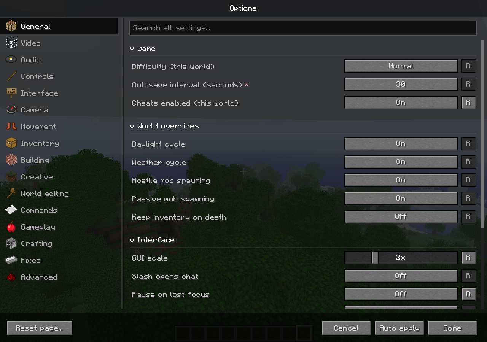
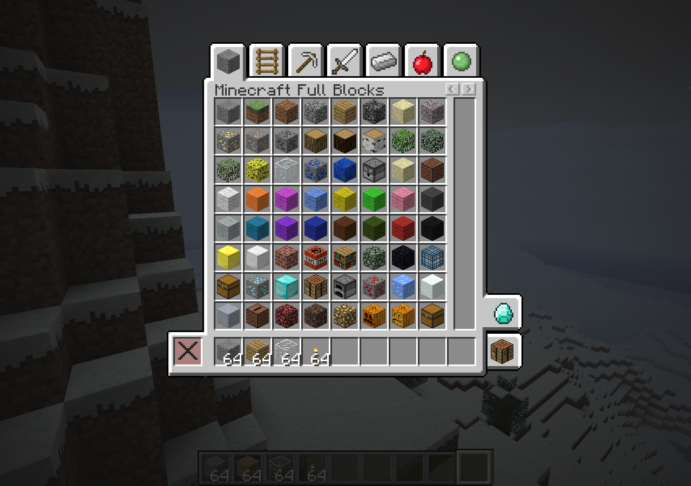
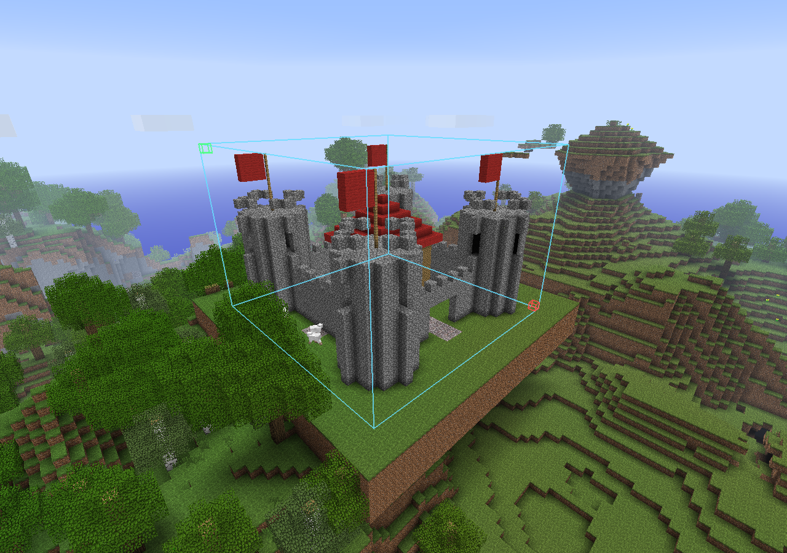
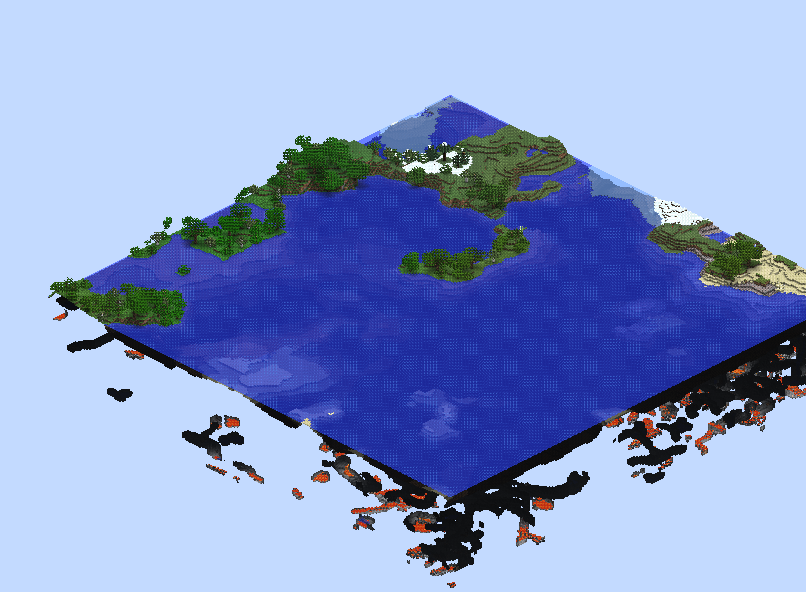
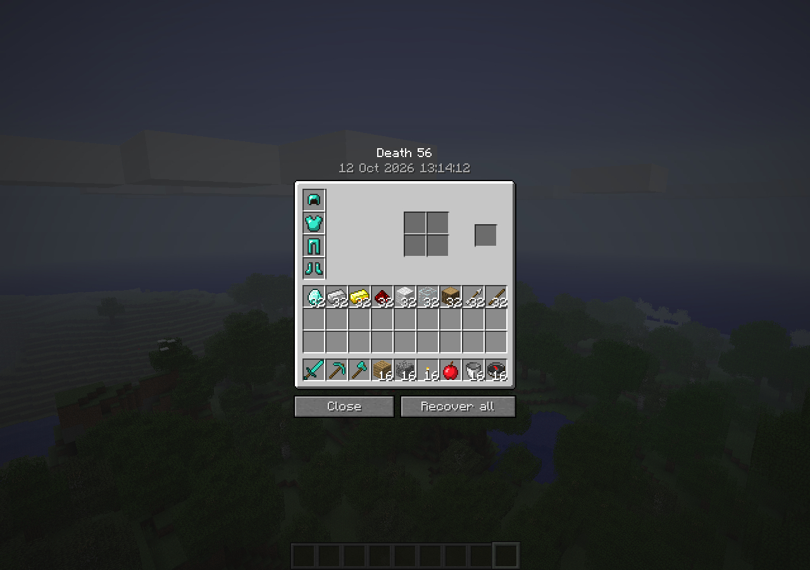
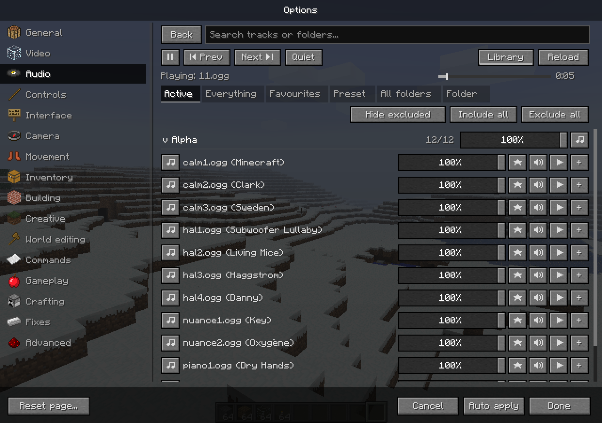

#  Power Beta

A configurable modpack for Minecraft Beta 1.7.3 with bug fixes, quality-of-life
improvements and optional tweaks in one searchable Options menu.

[Website and download](https://mc-power-beta.vercel.app/)

| Unified options menu | Creative mode |
| --- | --- |
| [](docs/screenshots/unified-menu.png) | [](docs/screenshots/creative-inventory.png) |

| WorldEdit | Isometric screenshots |
| --- | --- |
| [](docs/screenshots/worldedit.png) | [](docs/screenshots/isometric.png) |

| Death recovery | Music library |
| --- | --- |
| [](docs/screenshots/death-inventory.png) | [](docs/screenshots/music-library.png) |

## Features

- One searchable Options menu with categories, linked settings, tooltips, live previews, reset controls, automatic saving and optional Apply/Cancel editing.
- Configurable keyboard and mouse bindings, Ctrl/Shift/Alt chords, conflict detection and a shared view for resolving overlapping bindings.
- Creative and spectator modes, a mode picker, configurable reach, flight speed, drift and sprint, and adjustable spectator speed.
- Creative item categories and a survival inventory view. Shift-click for full stacks, middle-drag to fill slots, and use a destroy slot or clear the inventory.
- WorldEdit selections, outlines, fills, replacement, copying, pasting, shapes, undo and redo, with configurable work budgets and history.
- Commands with completion, editable history and help, including teleportation, saved warps, world spawn, time, weather, spawning and item commands.
- Chat selection, copy/paste, cursor navigation, scrolling, configurable history and fade time, and preserved colour across wrapped lines.
- Death records with locations, causes and original inventory layouts. View lost items and recover them with cheats, including crafting inputs. Optional per-world keep inventory.
- Free camera with adjustable speed, drag, collisions and separate player movement; free look, cinematic camera, field of view, adjustable third-person distance and front view.
- Isometric captures with rotation, scale and mirroring, custom-resolution screenshots, clipboard copying and photo mode.
- Fully lit rendering with a full-bright hotkey and optional automatic spectator lighting. Mob spawning and simulated light remain unchanged.
- Entity visibility controls for items, mobs, players, vehicles, projectiles and TNT. Entity and block-entity culling skips hidden rendering work.
- Optional dropped-item merging, explosion protection for dropped items and TNT work limits that can be enabled before loading a struggling world.
- Music libraries, custom tracks and folders, era selections, favourites, inclusion filters, per-track and per-folder volume, queues and saved presets.
- Music previews, seeking and playback controls in Options and the pause menu, with separate sound categories, ambience controls and optional extra interaction sounds.
- Flexible block placement with offset, adjacent, rotation, reverse and into-face modes, target overlays and destination previews.
- Fast placement with placement restrictions, item filters, orientation retention and slab rules. Complete slabs through adjacent faces.
- Container previews and carrying that preserves contents, including double chests. Optional inventory access in Nether portals.
- Quick inventory transfers, bulk crafting, drag distribution, double-click collection, scroll transfers, number-key hotbar swaps and stack dropping.
- Direct tool and armour swapping, Shift-click and right-click equipping, hotbar row swapping with previews, and optional use of the four crafting inputs as storage.
- Movement while compatible inventories are open, auto-walk, auto-mine, continuous click mining, step assist, edge protection and fence jumping.
- Faster boats and minecarts, boat steering and collision protection, boat elevators, minecart boosters and optional faster obsidian mining.
- Optional water landings and bucket clutches, including flowing water. Empty buckets stack to 16; doors and signs have optional modern stack limits.
- Individual modern recipes, shapeless recipes, tool repair, wool redyeing, adjusted slab/stair/trapdoor/ladder yields, material recovery, soul sand and otherwise unobtainable blocks.
- Per-world difficulty and cheat-gated daylight, weather, natural spawning and keep-inventory rules. Time freezing preserves the simulation clock.
- Natural spawning controls by mob type, spawn limits, light thresholds, group sizes and despawning, including saddled-pig preservation.
- Sleep controls for night skipping or acceleration, wake-on-click, nightmares and respawn-only beds; configurable rain, thunder, snow height and weather timing.
- Fast leaf decay, creative sapling drops, persistent placed leaves, leaf apple drops, dead-bush sticks, shears harvesting, log rotation and farmland protection.
- Sign editing and dye colouring, unsupported and glued trapdoors, blocked-chest opening, stackable chests, fence connections and pressure plates on fences.
- Optional gold-tool silk touch, hoe fortune, sword looting, fishing luck, gold-armour abilities, fire-curing golden apples and water-absorbing sponges.
- Explosion block damage and drop controls, TNT ignition and defusing, snowballs that extinguish fire, fire spread between entities and flaming arrows.
- Optional equipment durability and defence changes, mob drops, sheep punching for wool, grass hoeing for seeds, squid milking and food-waste prevention.
- Older block textures, softer rain and snow, low fire, redstone power numbers, leaf rendering, particle controls, camera shake and fog options.
- Light-level overlays, configurable active-tweak indicators and toggle messages, hotbar item names, HUD positioning, crosshair and vignette controls.
- Four custom HUD info clusters with separate positions, content and text styles, plus an optional 12-hour F3 daylight clock.
- Expanded F3 information for coordinates, facing, biome, day, play time, slime chunks, light, music and culling, with shared text colour and layout.
- Title-screen logo and panorama controls, version labels, achievement display options and recovery controls for missing achievements.
- Configurable autosaving, focus-loss pausing, raw mouse input and network options. Optional tall-grass and dead-bush generation controls for new terrain.
- Fixes for rendering, lighting, item and block drops, mining, boats, stairs, fences, liquids, mob behaviour, sleeping, multiplayer jitter and legacy client behaviour.

Most gameplay changes start off. Fixes, performance improvements and small
conveniences start on. Each world has its own Cheats switch for creative modes,
commands and world editing. Other settings are shared unless marked "this world".

## Install

1. Install [Prism Launcher](https://prismlauncher.org/) and add your Minecraft account.
2. [Download the Prism ZIP](https://mc-power-beta.vercel.app/download). If you have the source code
   instead, build that ZIP using the steps below.
3. In Prism, choose **Add Instance > Import**, then select the ZIP.
4. Open the instance's **Edit > Settings > Java**, enable the Java installation
   override and select **Java 21**. Download Java through Prism if needed.
5. Launch the instance. Open **Options** to browse or search settings and hover
   them for help. Auto apply is on by default. Turn it off to use **Apply** and **Cancel** for grouped edits.

The pack includes all required mods. Import the whole ZIP into a new instance.
Back up your worlds before replacing an existing installation.

## Build the ZIP from source

1. Install Java 21 and Python 3.
2. Download this repository with **Code > Download ZIP** and extract it, or clone it.
3. Open a terminal in the extracted folder. Set `JAVA_HOME` to your Java 21
   installation, then run:

   ```sh
   python3 tools/build_pack.py
   ```

4. Import the resulting `dist/Power-Beta-<version>-Prism.zip` into Prism as described above.

Development and update instructions are in [AGENTS.md](AGENTS.md). See
[releases](docs/releases.md) for publishing and [recovery](docs/recovery.md)
for inventory recovery. [Chat and WorldEdit](docs/commands.md) covers editing,
completion and block states. Changes are listed in the [changelog](CHANGELOG.md)
and [GitHub releases](https://github.com/lpke/mc-power-beta/releases).

Power Beta is maintained by its owner and does not accept contributions.
You are welcome to fork it and adapt it to your needs under the AGPL license.

## Inspired by

[BHCreative](https://github.com/paulevsGitch/BHCreative),
[Tweakeroo](https://github.com/maruohon/tweakeroo),
[WorldEdit](https://github.com/EngineHub/WorldEdit),
[Better Than Adventure](https://github.com/Better-than-Adventure),
[OmniLook](https://github.com/rhysdh540/Omnilook),
[UniTweaks](https://github.com/danygames2014/UniTweaks),
[StationAPI utilities](https://github.com/telvarost),
[Light Overlay](https://github.com/shedaniel/LightOverlay) and
[Click Mining Forever](https://github.com/snowtyler/click-mining-forever).

[AGPL-3.0-only](LICENSE). This is not an official Minecraft product.
